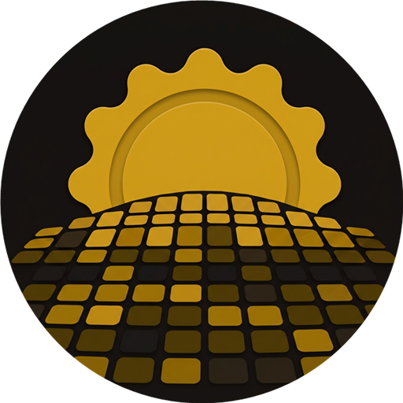
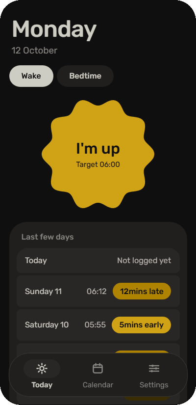
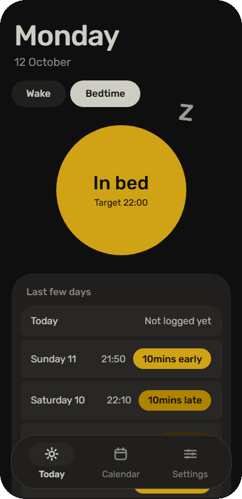
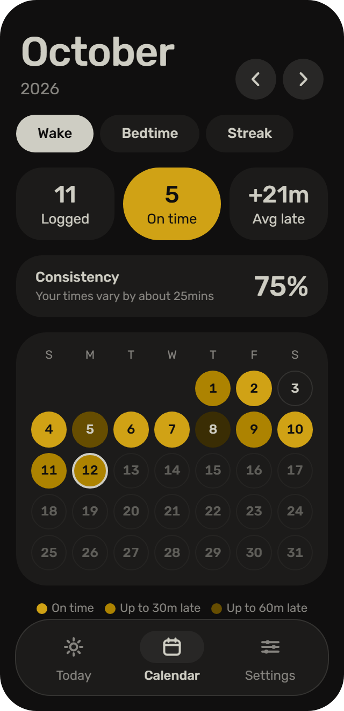
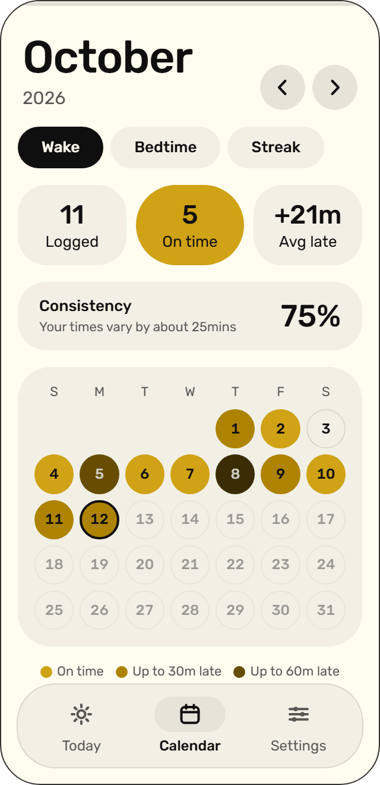
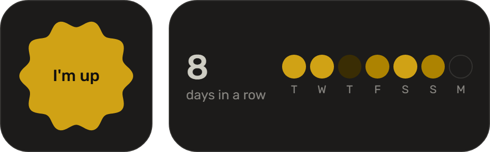

<h1 align="center">
  
  <br>
  Rise
</h1>

A mobile app for tracking when you wake up.

Waking is an exact moment: you wake, you log it. Rise is built around that one
tap. Bedtime can be tracked too, but it is optional, means "laid in bed" and
never affects your wake tracking.

> **Status:** beta, version 0.1.0. Expect rough edges, and please report what
> you find. Every feature below is built and covered by tests. The first
> version was checked on a phone on 2026-10-12; the later additions have
> phone checks still to tick at the end of the
> [design spec](docs/design.md), which describes the app in full. Four
> things appear only in the app's own build, not in Expo Go: the app icon, the
> launch screen, the wake-up reminder on Android, and the Android home-screen
> widgets. All four were found working on an Android phone on 2026-10-13.

## Preview

<p>
  
  
  
  
</p>

The first two pictures move, as the app does: the sun on the **I'm up**
button turns slowly, one turn a minute, and the **In bed** button lets off Zs
while it waits.

The Android home-screen widgets:

<p>
  
</p>

These pictures come from a mock-up of the app drawn for the web
(`docs/index.html`), not from a phone. It follows the app closely, but sizes
and timing differ a little. To try it yourself, download that file and open
it in a browser: the phone in it works.

## Disclosure

Rise is a vibe-coded application. It was built by describing what it should
do to an AI coding assistant, which wrote the code. The idea, the design
decisions and the checking on a real phone are the author's.

- **Code:** written by an AI assistant. Its logic and main flows are covered
  by automated tests, but it has not been reviewed line by line by a
  professional developer.
- **Colours and font:** not AI-made. The palette is
  [Flexoki](https://stephango.com/flexoki) by Steph Ango and the typeface is
  [Rubik](https://fonts.google.com/specimen/Rubik).

## Getting started

```bash
npm install
npx expo start      # then press a for Android, or scan the QR code with Expo Go
npm test            # unit tests and a whole-app test
npm run typecheck
```

If the app on your phone looks out of date, start it with `npx expo start -c`
to clear the cached bundle.

Expo Go has two limits:

- The wake-up reminder does not work in Expo Go on Android, because Expo Go
  there no longer includes notifications. The switch stays off and says why.
  It works in the app's own build on Android. On an iPhone it has not been
  tried.
- Expo Go shows its own icon and launch screen, not Rise's.
- The home-screen widgets do not exist in Expo Go. They need native code that
  only the app's own build has.

## Building

Builds run on [EAS Build](https://docs.expo.dev/build/introduction/), so no
Android SDK is needed on your machine. The app ID is `com.rensyi.rise` on
both Android and iOS, set in `app.json`. The build profiles are in `eas.json`.

```bash
npm i -g eas-cli
eas login
eas build -p android --profile preview      # an APK to install on a phone
eas build -p android --profile production   # an AAB for the Play Store
```

The first build asks to create the EAS project and writes its ID into
`app.json`. It also asks to generate a signing key; let it.

An iOS build needs a paid Apple developer account.

## How it works

Logging:

- **One tap to log.** The app opens on Today with one big sun-shaped button.
  Press **I'm up** and the current time is saved for today.
- **Undo.** The "Logged 06:12" message has an Undo button for five seconds.
- **Fix it later.** Tap any past day to add, change or delete an entry.
- **The last few days.** Today lists the past five days at a glance.

The calendar:

- **The calendar is the heat map.** Each day is coloured by how close you woke
  to your target, like GitHub's contribution tiles, but on the calendar days
  themselves.
- **Monthly stats.** Days logged, days on time, and average minutes late.
- **Consistency.** A score for how close together the month's times are,
  whatever your target.
- **Streak.** A tab on Calendar, set up your way: what makes a day count
  (logged, within 30 minutes, or on time), and whether to count days in a
  row, the last seven days, or this week since Sunday.

Targets:

- **Your target, your colours.** The default target is 06:00. Set it to 09:00
  and a 09:00 wake-up gets the strongest colour.
- **The past stays put.** Changing your target affects new days only. Past
  colours and stats change only if you turn on "Apply targets to past days".
- **Weekend targets.** An optional later target for Saturday and Sunday
  mornings, and for Friday and Saturday nights if you track bedtime.

Optional extras:

- **Reminder.** A notification at your wake-up target. It is skipped on a day
  you have already logged. It is a notification, not an alarm.
- **Backup.** Export everything to one file, and restore from it. Restoring
  shows what is in the file and asks before replacing anything.
- **Home-screen widgets (Android).** A small one with the **I'm up** button,
  which logs your wake-up with one tap without opening the app, and a wide
  one with your streak and the last seven days.
- **Bedtime is opt-in.** Turn it on in Settings to get a separate Bedtime view
  with its own target, colours and stats.
- **Your clock, your theme.** Times show in 12- or 24-hour format and the app
  in light or dark. Both follow your phone by default and can be set in
  Settings.

The app has three places, on a floating bar at the bottom: Today for logging,
Calendar for the month, and Settings.

### Tile colours

| Tile | Woke up | With a 06:00 target |
|---|---|---|
| Strongest | at or before target | 06:00 or earlier |
| Strong | up to 30 min after | up to 06:30 |
| Medium | up to 60 min after | up to 07:00 |
| Faint | more than 60 min after | after 07:00 |
| Empty | not logged | — |

### Look

"Ink and gold": warm paper and ink with one gold, in a dark and a light
theme, set in Rubik. The colours are from
[Flexoki](https://stephango.com/flexoki) by Steph Ango.

| | Dark | Light |
|---|---|---|
| Background | `#100F0F` | `#FFFCF0` |
| Cards | `#1C1B1A` | `#F2F0E5` |
| Rows on a card | `#282726` | `#E6E4D9` |
| Text | `#CECDC3` | `#100F0F` |
| Secondary text | `#878580` | `#575653` |

Tiles are the same in both themes, from on time to latest:
`#D0A215`, `#AD8301`, `#664D01`, `#3A2D04`.

The shapes follow Material 3 Expressive: large titles, pills and circles, and
one playful shape, the scalloped sun on the log button. Switches are drawn by
the app, so they look the same on Android and iPhone.

Movement is short and answers what you just did: the sun turns slowly, the
"In bed" button lets off Zs, a logged time springs in, calendar tiles pop in
as a wave, and sheets slide up and back down. With the phone's "reduce
motion" setting on, none of it plays.

## Your data

Everything is stored on the phone. There is no account and nothing is sent
anywhere. The only way data leaves the phone is a backup file you export
yourself.

## Why 06:00

No study names a single best wake-up time. The default is derived from three
findings:

- Sleep regularity predicted mortality better than sleep duration in about
  61,000 adults
  ([Windred et al., 2024](https://www.ncbi.nlm.nih.gov/pmc/articles/PMC10782489/)).
- Each one-hour-earlier sleep midpoint was associated with about 23% lower
  risk of major depression
  ([Daghlas et al., 2021, coverage](https://sleepreviewmag.com/sleep-health/sleep-whole-body/mental-health/waking-one-hour-earlier-cuts-depression-risk/)).
- Falling asleep between 22:00 and 23:00 had the lowest cardiovascular risk
  in about 88,000 adults
  ([2021 study, coverage](https://www.thestar.co.uk/read-this/going-to-sleep-between-10pm-and-11pm-linked-to-lower-heart-disease-risk-study-finds-3450483)).

A 22:00–23:00 sleep onset plus 7–9 hours of sleep gives a wake window of
about 05:00–08:00. 06:00 sits inside it. The right time differs by person,
which is why the target is adjustable. These studies show association, not
cause, and Rise is a habit tracker, not medical advice.

## Tech stack

- [Expo](https://expo.dev) (React Native, TypeScript)
- [React Native Paper](https://callstack.github.io/react-native-paper/) for
  Material 3 components
- [react-native-paper-dates](https://web-ridge.github.io/react-native-paper-dates/)
  for the Material 3 time picker
- react-native-svg for the sun's outline
- React Native's built-in `Animated` for all movement; no animation library
- [Rubik](https://fonts.google.com/specimen/Rubik) through
  `@expo-google-fonts/rubik`
- AsyncStorage for on-device data
- expo-notifications for the reminder, scheduled on the phone itself
- expo-sharing, expo-document-picker and expo-file-system for backup and
  restore
- expo-splash-screen for the launch screen
- [react-native-android-widget](https://saleksovski.github.io/react-native-android-widget/)
  for the Android home-screen widgets
- Jest (`jest-expo`) for tests
- [EAS Build](https://docs.expo.dev/build/introduction/) for the installable
  app

## Structure

```
index.ts                     entry point
App.tsx                      state, theme selection, font loading, Shell
App.test.tsx                 whole-app test
app.json                     Expo config: app ID, icons, launch screen, plugins
eas.json                     EAS Build profiles
jest.global-setup.js         fixed time zone for tests
src/
  theme.ts                   colours, font, light and dark themes
  theme.test.ts              unit tests
  lib/time.ts                pure logic: levels, labels, targets, stats, streak
  lib/time.test.ts           unit tests
  lib/sun.ts                 outline of the wake button
  lib/sun.test.ts            unit tests
  storage.ts                 load, save, and the backup file's format
  storage.test.ts            unit tests
  useRise.ts                 state hook
  reminder.ts                schedules the wake-up reminder
  reminder.test.ts           unit tests
  reminder.expo-go.test.ts   unit tests for Expo Go on Android
  backup.ts                  shares a backup file, picks one to restore
  widget/
    index.ts                 loads the widgets only where they can run
    state.ts                 what the widgets show, and the one-tap log
    widgets.tsx              the two widgets, and what happens on a tap
    *.test.ts(x)             unit tests
  Shell.tsx                  shared screen state, bottom bar, sheets, messages
  screens/
    TodayScreen.tsx          log button or result, last few days
    CalendarScreen.tsx       month, with Wake, Bedtime and Streak tabs
    SettingsScreen.tsx       grouped settings
  components/
    BigTitle.tsx  Panel.tsx  Pills.tsx  SunButton.tsx  LatenessPill.tsx
    NavBar.tsx  DaySheet.tsx  TimeField.tsx  MonthCalendar.tsx  StatsRow.tsx
    Motion.tsx  Sheet.tsx  RestoreSheet.tsx  StreakView.tsx  Toggle.tsx
    TimeField.test.tsx
assets/                      icons and the launch image; see assets/README.md
docs/design.md               design spec, and what is left to check on a phone
docs/index.html              a working mock-up of the app for the browser
docs/shots/                  the pictures above, taken from the mock-up
```

## Not planned

Alarms, sleep duration, accounts or sync, charts, and widgets on iPhone.
